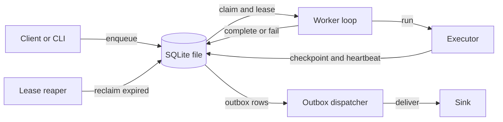
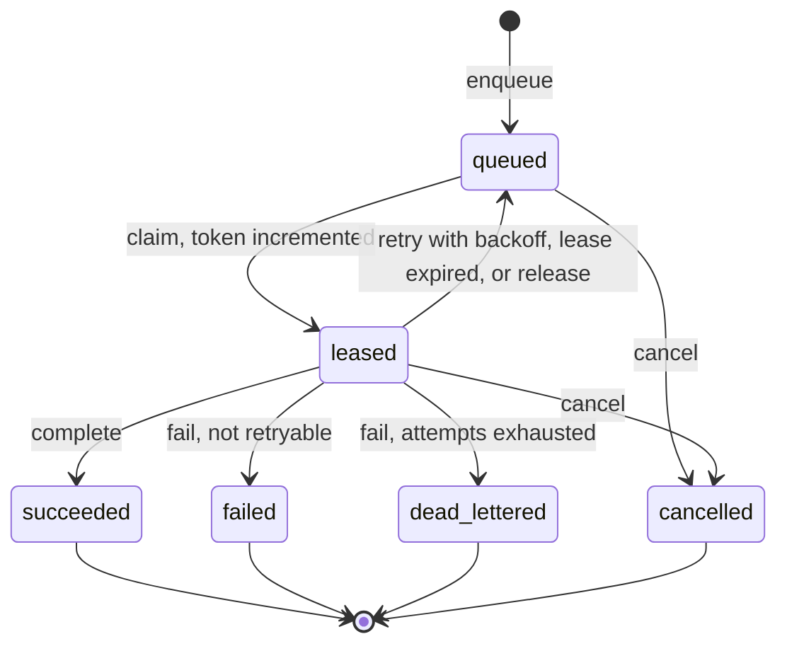
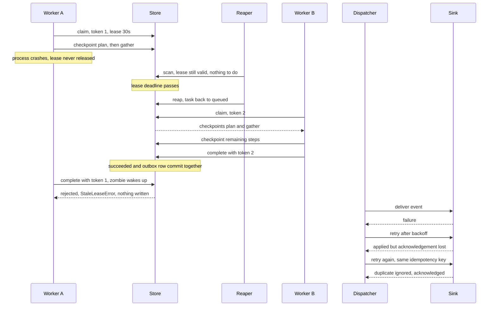

# agent-task-runtime

A crash-safe, lease-based task runtime for long-running AI-agent jobs, as a compact,
dependency-free Python package on top of SQLite.

> **An independent reference implementation, written from scratch for demonstration; not
> extracted from any production system.** All names and data in this repository are
> fictional. Built with AI coding assistance (Claude Code). Nothing here has been benchmarked or run in
> production, and no performance
> or scale claims are made.

## The problem

Agent jobs are long, multi-step and unreliable in boring ways. A job that researches a
topic, drafts a report and reviews it can take minutes; during that time the worker can be
killed, stall, lose its network, or simply be slow enough that the system *thinks* it died.
A naive queue (`pop`, run, `ack`) answers each of those with data loss, duplicated work, or
a corrupted result. The hard cases are the ones where two workers both believe they own the
same task:

* worker A stalls, its lease expires, worker B takes over, then A wakes up and finishes
  "its" task, overwriting B's result (the **zombie worker**);
* a task finishes, but the process dies before the downstream system is told (the
  **dual-write** problem);
* a retried job starts from scratch and repeats twenty minutes of expensive steps
  (**lost progress**).

This repository is a small, readable implementation of the standard answers: leases,
fencing tokens, checkpoints and a transactional outbox, with a state machine and an audit
log tying them together.

## What it does

| Concern | Mechanism |
|---|---|
| Who owns a task? | Time-limited **lease** taken in one `BEGIN IMMEDIATE` transaction |
| Can a stale owner do damage? | Monotonic **fencing token** checked on every write; stale writes are rejected and change nothing |
| Worker died | **Lease reaper** re-queues expired leases (or dead-letters when attempts run out) |
| Transient failure | **Retry policy**: exponential backoff, bounded jitter, max attempts, then dead letter |
| Duplicate submissions | **Idempotent enqueue** by caller-supplied key |
| Lost progress | Per-step **checkpoints**; a retried attempt resumes instead of restarting |
| Tell the outside world | **Transactional outbox**: terminal state and event commit together; a dispatcher delivers at-least-once with a stable idempotency key |
| What happened? | **Append-only event log** enforced by database triggers |
| Schema evolution | **Versioned, run-once migrations** recorded in `schema_migrations` |
| Running jobs | **Worker loop**, pluggable `Executor` protocol, graceful shutdown |

## Guarantees

These hold for a single SQLite database file on a local filesystem, with every process
using this library:

1. **Exclusive claims.** A task has at most one current fencing token, and a claim hands out
   each task attempt to exactly one claimer, even with many concurrent claimers (tested with
   threads on separate connections).
2. **Atomic transitions.** A state change, its audit-log row and, for terminal states, its
   outbox row are written in one transaction, or not at all.
3. **Fencing.** `complete`, `fail`, `heartbeat`, `save_checkpoint` and `release` with a
   superseded token raise `StaleLeaseError` and write nothing. The tests compare the task,
   its audit log, its checkpoints and its outbox before and after each rejected call.
4. **Terminal states are final.** The transition table is enforced on every write; illegal
   transitions raise `IllegalTransitionError`.
5. **Durability of committed work.** Committed state survives a process crash or restart
   (WAL mode, `synchronous=FULL`), assuming the OS and disk honour `fsync`.
6. **At-least-once outbox delivery.** An event committed with a terminal state is delivered
   at least once as long as a dispatcher keeps running; a row is marked delivered only after
   the sink returns.
7. **Idempotent enqueue.** One key, one task. Reusing a key with a different kind or payload
   raises `IdempotencyConflictError` instead of silently returning the wrong task.

## Explicit non-guarantees

* **Not exactly-once execution.** If a worker crashes after performing an external side
  effect but before `complete`, the next attempt will perform it again. Executors must make
  side effects idempotent, or pass the fencing token to the downstream system so *it* can
  reject stale writers. Fencing protects this store; it cannot reach into other systems.
* **Not exactly-once delivery.** The outbox is at-least-once. Effectively-once processing
  needs an idempotent consumer keyed on the event's idempotency key (`DedupSink` shows how).
* **A zombie keeps running until it touches the store.** Fencing detects a stale owner at
  its next fenced write, not before.
* **No ordering guarantee for outbox delivery** once any delivery has failed and been retried.
* **Not distributed.** One file, one host. Network filesystems are not supported. Lease
  expiry compares wall-clock timestamps, so all processes must share a clock; a clock step
  can expire leases early or late.
* **No fairness or timeliness guarantees** beyond priority-then-FIFO. Sustained
  high-priority load can starve low-priority tasks.
* **Cancellation is cooperative.** Cancelling a leased task invalidates the worker's token,
  but the executor only finds out at its next fenced call.
* **No throughput claims.** There are no benchmarks in this repository.

## Architecture



Everything that matters lives in one module, `store.py`. Each public method is a single
`BEGIN IMMEDIATE` transaction, so SQLite's single-writer lock is the serialisation
mechanism. Tables:

| Table | Purpose |
|---|---|
| `tasks` | Current state, priority, fencing token (`attempt`), lease owner and deadline |
| `task_events` | Append-only audit log; `UPDATE` and `DELETE` are blocked by triggers |
| `checkpoints` | Latest output per `(task, step)` |
| `outbox` | Events awaiting delivery, with `next_attempt_at` backoff state |
| `schema_migrations` | Which versioned migrations have run |

### Task lifecycle



* `failed` means the executor said retrying cannot help (`PermanentError`).
* `dead_lettered` means retries were exhausted, either through repeated failures or repeated
  lease expiries. Both are terminal and both emit an outbox event.
* A lease expiry re-queues immediately (a crash is not the task's fault), while a reported
  failure waits for exponential backoff.

### Crash, takeover and fencing



## Quickstart

Requires Python 3.11+ and `uv`. The runtime has no third-party
dependencies; `pytest` and `ruff` are dev-only.

```bash
uv sync
uv run pytest -q
uv run ruff check .
uv run ruff format --check .
uv run python -m agent_task_runtime demo
```

Using it as a library:

```python
from agent_task_runtime import ListSink, OutboxDispatcher, SimulatedAgentExecutor, TaskStore, Worker

with TaskStore("tasks.db") as store:
    store.enqueue("agent.research", {"topic": "example"}, idempotency_key="job-1")
    Worker(store, SimulatedAgentExecutor(), worker_id="worker-1").run_until_idle()
    sink = ListSink()
    OutboxDispatcher(store, sink).run_once()
    print(sink.received[0].event_type)  # task.succeeded
```

Writing an executor means implementing one method. Return a JSON-serialisable result, or
raise `PermanentError` (do not retry), `ShutdownRequested` (hand the task back), or anything
else (retry with backoff). This is an illustrative sketch, not runnable as-is:

```python
class MyExecutor:
    def execute(self, ctx):  # ctx: TaskContext
        for step in STEPS:
            if step in ctx.checkpoints:  # finished by an earlier attempt
                continue
            ctx.raise_if_stopping()  # cooperative graceful shutdown
            output = do_step(step, ctx.task.payload)
            ctx.checkpoint(step, output)  # durable, fenced
            ctx.heartbeat()  # renew the lease
        return {"done": True}
```

### CLI

```bash
uv run python -m agent_task_runtime demo                  # deterministic simulation
uv run python -m agent_task_runtime enqueue --kind agent.research \
    --payload '{"topic": "example-report"}' --key report-1 --priority 5
uv run python -m agent_task_runtime stats                 # counts by state, outbox backlog
uv run python -m agent_task_runtime work --once           # drain the queue with simulated executors
uv run python -m agent_task_runtime inspect               # list tasks
uv run python -m agent_task_runtime inspect TASK_ID       # one task: state, checkpoints, audit log, outbox
uv run python -m agent_task_runtime dispatch --once       # print due outbox events as JSON lines
```

All commands take `--db PATH` (default `agent-task-runtime.db` in the current directory,
which is git-ignored). `work` without `--once` polls until `SIGINT` or `SIGTERM`, then
finishes or releases its current task and exits. Simulated executor kinds: `agent.research`
(five checkpointed steps), `demo.flaky` (fails twice, then succeeds), `demo.fail`
(permanent failure).

## Demo

`python -m agent_task_runtime demo` runs the whole scenario on a virtual clock with a
seeded RNG: no sleeping, no network, reproducible output. Real output:

```text
agent-task-runtime demo: virtual clock, seeded RNG, no network, no sleeping
lease = 30s, each simulated agent step = 2s

--- 1. enqueue (idempotent) ---
[t=   0.0s] client    enqueue task-demo-1 priority=5 -> created=True
[t=   0.0s] client    enqueue same idempotency key -> created=False, same id: True

--- 2. worker-A claims, works, then crashes mid-task ---
[t=   0.0s] worker-A  claimed task-demo-1: attempt=1, fencing token=1, lease until t=30.0s
[t=   0.0s] worker-A  running step 'plan' ...
[t=   2.0s] worker-A  running step 'gather' ...
[t=   4.0s] worker-A  CRASH before step 'analyze' (process dies; lease not released)
[t=   4.0s] store     checkpoints on disk: ['plan', 'gather']; task state=leased

--- 3. lease expires; reaper reclaims ---
[t=  20.0s] reaper    scan: 0 expired leases (lease still valid until t=34.0s)
[t=  36.0s] reaper    lease expired -> task-demo-1 back to 'queued' (attempts used: 1/5)

--- 4. worker-B takes over and resumes from checkpoint ---
[t=  36.0s] worker-B  claimed task-demo-1: attempt=2, fencing token=2
[t=  36.0s] worker-B  resuming; checkpoints found: ['plan', 'gather']
[t=  36.0s] worker-B  running step 'analyze' ...
[t=  38.0s] worker-B  running step 'draft' ...
[t=  40.0s] worker-B  running step 'review' ...
[t=  42.0s] worker-B  completed task-demo-1; result.ran=['analyze', 'draft', 'review'], resumed=['plan', 'gather']
[t=  42.0s] store     terminal state AND outbox event were committed in one transaction

--- 5. zombie worker-A wakes up and tries to finish ---
[t=  46.0s] zombie-A  heartbeat(token=1) REJECTED: stale lease on task-demo-1: presented fencing token 1, current token is 2 and task state is succeeded
[t=  46.0s] zombie-A  checkpoint(token=1) REJECTED: stale lease on task-demo-1: presented fencing token 1, current token is 2 and task state is succeeded
[t=  46.0s] zombie-A  complete(token=1) REJECTED: stale lease on task-demo-1: presented fencing token 1, current token is 2 and task state is succeeded
[t=  46.0s] store     unchanged: state=succeeded, attempt=2, result.ran=['analyze', 'draft', 'review']

--- 6. process restart, then outbox delivery (at-least-once) ---
[t=  46.0s] process   closing the database and reopening the file (simulated restart)
[t=  46.0s] store     after restart: outbox pending=1, delivered=0
[t=  46.0s] dispatch  delivery of task.succeeded FAILED (SinkUnavailableError: downstream unavailable (simulated)); retry at t=46.8s
[t=  46.8s] dispatch  delivery of task.succeeded FAILED (SinkUnavailableError: downstream unavailable (simulated)); retry at t=48.7s
[t=  48.7s] sink      EFFECT applied for key=task-demo-1:task.succeeded
[t=  48.7s] dispatch  delivery of task.succeeded FAILED (AckLostError: sink applied the event but the acknowledgement was lost); retry at t=51.4s
[t=  51.4s] dispatch  delivered task.succeeded key=task-demo-1:task.succeeded (duplicate delivery ignored by the dedup sink)
[t=  51.4s] dispatch  outbox: 1 delivered, 0 pending; sink attempts=4, effects applied=1, duplicates ignored=1

--- 7. append-only audit log for the task ---
  #1  t=   0.0s  client           enqueued       - -> queued          attempt=0
  #2  t=   0.0s  worker-A         claimed        queued -> leased     attempt=1
  #3  t=  36.0s  reaper           lease_expired  leased -> queued     attempt=1
  #4  t=  36.0s  worker-B         claimed        queued -> leased     attempt=2
  #5  t=  42.0s  worker-B         succeeded      leased -> succeeded  attempt=2

invariants held: 1 terminal state, 1 effect applied, 1 duplicate absorbed, 0 zombie writes
```

Read it top to bottom: worker A's token is 1 and it dies after checkpointing two steps;
the reaper ignores the lease until its deadline passes; worker B gets token 2 and runs only
the three remaining steps; A's three late writes are all rejected with state unchanged;
the database is closed and reopened and the outbox row is still there; delivery fails
twice, then the sink applies the event but loses the acknowledgement, and the redelivery is
absorbed by the deduplicating sink. The outbox row records four delivery attempts: two
outage failures, one lost acknowledgement and the final deduplicated redelivery.

## Design tradeoffs

The full rationale is in [`docs/design.md`](docs/design.md). The short version:

**Why SQLite.** A reference implementation should be runnable with `git clone` and nothing
else, and SQLite gives real transactions, a real write lock and real durability in the
standard library. It makes the *protocol* (lease, token, outbox) the interesting part rather
than the infrastructure. The cost is one writer at a time and one host.

**At-least-once, not exactly-once.** Exactly-once across a process boundary is not
achievable in general; what is achievable is at-least-once plus idempotent consumers, which
behaves like exactly-once for the effects you care about. The outbox gives the first half
and every event carries a stable key (`<task_id>:<event_type>`) for the second.

**Lease duration.** Too short and healthy-but-slow workers get their tasks stolen (wasted
work, more zombies); too long and a crashed worker's task sits idle until the lease runs
out. The runtime does not pick a number for you: the default is 30 seconds purely as a
placeholder. Executors renew the lease with `ctx.heartbeat()` between steps, so the lease
only needs to cover the longest *single step*, not the whole job. Per-claim overrides are
supported.

**Fencing tokens.** A lease alone is not safe: a paused process cannot know its lease
lapsed. Every write is conditioned on the token being current, and the token is the claim
counter, so it needs no extra column and is monotonic by construction. The store enforces
it for its own tables; for external side effects you must forward the token downstream.

**What would change for Postgres or multi-node.** The protocol stays; the mechanics change.
Claim becomes `SELECT ... FOR UPDATE SKIP LOCKED` in a transaction. Lease deadlines should
use the database server's clock (`now()`) instead of worker clocks, removing the shared-clock
assumption. The outbox dispatcher needs partitioning or advisory locks so several
dispatchers do not all send the same rows, and ordering needs a per-key partition. Workers
need a background heartbeat thread, because a blocked executor cannot renew its own lease.
None of that is implemented here.

## Status

| Area | Status |
|---|---|
| Task state machine and transition enforcement | Implemented and tested |
| Atomic claim, priority and FIFO ordering, concurrent claimers | Implemented and tested |
| Leases, fencing tokens, heartbeat, stale-write rejection | Implemented and tested |
| Lease reaper (requeue and dead-letter on exhaustion) | Implemented and tested |
| Retry policy with injectable clock and RNG | Implemented and tested |
| Idempotent enqueue, including concurrent duplicates | Implemented and tested |
| Checkpoints and resume after crash | Implemented and tested |
| Transactional outbox, dispatcher, backoff, restart survival | Implemented and tested |
| Append-only audit log | Implemented and tested |
| Versioned migrations (run-once, rollback on failure, race-safe) | Implemented and tested |
| Worker loop, `Executor` protocol, graceful shutdown | Implemented and tested |
| `DedupSink` (effectively-once consumer example) | Implemented and tested; a demonstration, not a production consumer |
| Simulated executors and the deterministic demo | Implemented and tested; simulations only, no real agent or model calls |
| CLI `demo`, `enqueue`, `stats`, `inspect`, `work --once`, `dispatch --once` | Implemented and tested |
| CLI long-running `work` and `dispatch` loops with signal handling | Prototype: run once during the build (clean exit on `SIGTERM`), not covered by automated tests |
| Background heartbeat thread for blocking executors | Conceptual, not implemented |
| Postgres backend, multi-node operation, server-side clocks | Conceptual, not implemented |
| Outbox ordering, partitioning, poison-event handling | Conceptual, not implemented |
| Per-kind concurrency limits, task dependencies, scheduling | Conceptual, not implemented |
| Retention and pruning, metrics, tracing, authentication | Conceptual, not implemented |

## Limitations

* Single host, single SQLite file; do not put it on a network filesystem.
* One writer at a time. Many workers are supported, but they serialise on the write lock.
* The lease clock is the caller's wall clock (`time.time()`), which is not monotonic.
* Heartbeats are explicit calls from the executor; a blocking call inside a step cannot
  renew its own lease.
* Graceful release consumes an attempt, because the attempt counter *is* the fencing token.
  Repeated restarts of a long task could therefore exhaust `max_attempts`.
* A failed outbox delivery is retried forever with capped backoff; there is no
  dead-letter state for outbox rows.
* `DedupSink` guarantees effectively-once only when the handler's effect and the dedup key
  share a transaction. Against an external system it narrows duplicates but cannot eliminate
  them.
* Payloads and results are stored as JSON text with no size limits or schema validation.
* The audit log is append-only against ordinary statements; anyone with write access to the
  file can drop the triggers, and there is no hash chain, so it is neither tamper-proof nor
  tamper-evident.
* The CI workflow targets Python 3.11 to 3.13; the tests were run locally on 3.11 and 3.14.

## Repository layout

```text
src/agent_task_runtime/
  store.py        all state transitions, one transaction each
  models.py       Task, events, state machine table
  migrations.py   versioned run-once migrations
  retry.py        RetryPolicy (backoff and jitter)
  clock.py        Clock protocol, SystemClock, ManualClock
  worker.py       Worker, TaskContext, Executor protocol
  executors.py    simulated executors, SimulatedCrash
  outbox.py       OutboxDispatcher
  sinks.py        Sink protocol, DedupSink and simulated flaky sinks
  demo.py         scripted simulation
  cli.py          command-line interface
tests/            pytest suite
docs/design.md    deeper design rationale
```

## License

MIT. See [LICENSE](LICENSE). Copyright (c) 2026 Donovan Fitch.
